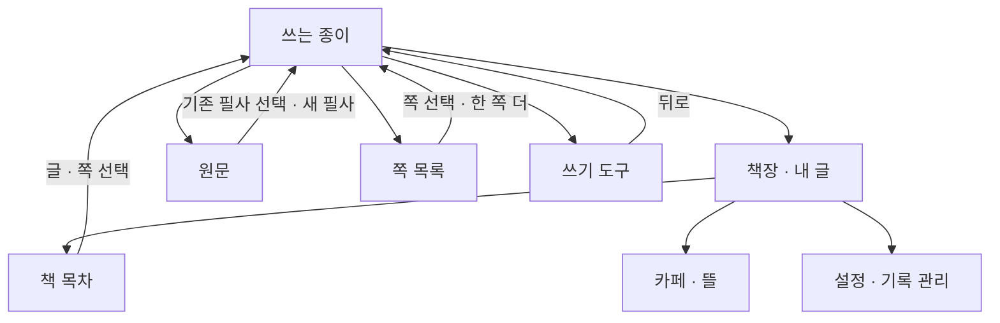

# 이동 방식과 전체 동선

2026-11-27 전체 화면·중앙 제목·공통 가장자리 복귀 반영. 11월25일 패널 방식은 이전 설계다. 공통 복귀와 아래 화면 동선을 앱 코드에 적용했다. 기존
[대표 시안](../design/navigation/20261125/navigation-concept-v2.png)은 생성 이미지이며 11월25일의
구현은 [이전 Flutter 렌더](../output/navigation-implementation-20261125/screens/04-tools-sheet.png)와
[검증 기록](verification.md)의 실행 범위로 구분한다. 공개 웹 배포는 검증 기록의 ‘공통 이동 동선의 웹 배포 확인’에 남겼다. 실기기 검증은 별도다.
현재 전체 화면 렌더는 `output/navigation-fullscreen-20261127/screens/`에 보관한다.
신규/변경 화면은 이 문서와 [제품](product.md)·[구조](architecture.md)·[페르소나](brand-personas.md)를 따른다.

## 가장 먼저 기억할 기준

**쓰던 종이가 중심이다. 살펴보는 동안에는 그 종이가 바뀌지 않고, 다른 글·쪽을 직접
선택하거나 새 글·필사를 시작할 때에만 작성 대상이 바뀐다.**

앱 시작은 마지막 쪽 또는 첫 빈 종이다. 책 없이 쓸 수도 있다. 책을 꼭 고르거나
원문을 먼저 담아야 본문을 쓸 수 있는 구조를 만들지 않는다.

| 사용자의 행동 | 결과 | 쓰던 종이를 바꾸는가? |
| --- | --- | --- |
| 책장·원문·사진·검색을 살펴보기 | 보던 화면을 연다 | 아니오 |
| 뒤로 / 쓰던 쪽 | 이전 화면 / 탐색을 시작한 종이로 복귀 | 아니오 |
| 목차·쪽 목록의 글/쪽 선택, 이어서 쓰기 | 선택한 대상의 기존 쪽을 연다 | 예 |
| 새 글 / 필사하기 / 새로 필사하기 | 별도 글의 첫 쪽을 연다 | 예 |
| 한 쪽 더 | 같은 글에 원문 없는 빈 쪽을 추가한다 | 예 |
| 도구·종이·꾸미기 조절 | 해당 설정을 바꾼다 | 쪽·본문·선택 위치는 유지 |

## 전체 구조

쓰기 화면의 기존 진입점을 유지한다. 책장은 위쪽, 원문·쪽 목록·도구는 종이 아래쪽에서
연다. 설정과 카페는 책장 안에 둔다. 여러 기능을 오가려고 항상 보이는 새 탭 막대를
추가하거나 종이 좌우 스와이프로 기능 화면을 바꾸지 않는다.

원문·책장·설정·카페에서 읽고 살펴보는 것과, 종이로 돌아가 쓰는 것을 구분한다.
다른 쪽을 선택했다면 그 쪽이 이후의 새 작성 기준점이다. 이미 선택을 마친 탐색 화면을
그 종이 뒤에 쌓아 두어 뒤로를 누를 때 다시 나타나게 하지 않는다.

## 사용 목적별 실제 순서

| 하고 싶은 일 | 들어가는 순서 | 끝나거나 돌아올 때 |
| --- | --- | --- |
| 지금 글 계속 쓰기 | 앱 열기 → 쓰던 종이 | 본문을 누르고 바로 입력. 종이를 다시 고르는 단계 없음 |
| 현재 필사의 원문 확인 | 종이의 원문 → 연결된 원문 바로 읽기 → 필요하면 사진 | 사진의 뒤로는 그 원문, 원문의 뒤로는 종이. 거치지 않은 목록을 강제로 끼우지 않음 |
| 다른 원문 골라 필사 | 원문 → 원문 목록 → 원문 읽기 | 필사하기는 새 글 첫 쪽. 기존 필사가 있으면 이어서 쓰기가 주 행동, 새로 필사하기가 보조 행동 |
| 원문 없는 종이에서 필사 시작 | 원문 → 원문 목록의 담기/찾기 → 원문 읽기 | 담기만 하면 원문 읽기까지. 명시적으로 필사하기를 골라야 새 글 시작 |
| 소설 구절 골라 필사 | 원문 목록 → 새 원문 찾기 → 소설 → 필사할 구절 | ‘필사하기’로 고른 구절 하나를 저장하고 새 글 첫 쪽으로 이동. 뒤로는 보던 작품 목록과 검색 조건 |
| 새 자료 담기 | 원문 목록 → 원문 담기 또는 새 원문 찾기 → 사진/본문 확인 | 담기는 저장한 원문 읽기. 취소는 호출한 목록/화면. 글이나 쪽을 자동 생성하지 않음 |
| 예전 글 찾아 쓰기 | 책장 또는 내 글 → 책 목차/글 선택 → 기존 쪽 | 선택한 글의 해당 쪽을 펼치며 탐색을 정리. 목차는 별도 ‘책 화면’을 한 번 더 거치지 않음 |
| 책 꾸미기 | 책장 → 책 목차 → 책 꾸미기 → 장식/재질 | 세부 뒤로는 꾸미기 목록, 그 뒤로는 같은 책 목차. 종이를 바꾸지 않음 |
| 쪽·표지 찾기 | 종이의 쪽수 → 쪽 목록 → 쪽/표지 선택 | 선택한 면을 바로 펼침. 한 쪽 더는 같은 글의 빈 쪽, 원문 안내는 따라오지 않음 |
| 펜·형광펜·지우개 바꾸기 | 쓰기 도구 → 같은 전체 화면에서 고르기/조절 | 뒤로 또는 왼쪽 가장자리 스와이프로 같은 글·커서에 선택한 도구로 복귀 |
| 관리·동기화 | 책장 → 설정 → 기록 관리/다른 기기에서 이어 쓰기 | 한 단계씩 호출 화면으로 복귀. 계정 변경은 별도 소유자 검사 |
| 카페에서 쉬기 | 책장 → 카페·뜰 → 필요한 분위기/꾸미기 | 뒤로는 책장, 쓰던 쪽은 종이로 바로 복귀. 공간의 출입문은 카페 안팎 이동 |

‘목차/글 선택’의 첫 쪽·최근 쪽 등 대상 선정은 기존 제품 규칙을 따른다. 이번 재정리로
그 선정 정책을 조용히 바꾸지 않는다. 다만 ‘이어서 쓰기’는 화면에서 고른 대상의
쓰던 위치를 가리켜야 하며, 출발했던 다른 글로 돌아간다는 뜻으로 쓰지 않는다.

## 버튼의 뜻과 자리

복귀는 두 가지다. **뒤로는 바로 전 화면, 쓰던 쪽은 이번 탐색을 시작한 종이**다.
‘이어서 쓰기’는 복귀 버튼이 아니라 선택한 글을 여는 주 행동이다.

| 구분 | 표시와 자리 | 목적지 |
| --- | --- | --- |
| 한 단계 돌아가기 | 화면 위 왼쪽 꺾쇠 아이콘. 실제 목적지는 툴팁·접근성 이름으로 제공 | 실제로 들어온 화면. 목록의 검색·스크롤도 복원 |
| 종이로 바로 복귀 | 깊은 읽기/탐색 화면 위쪽의 연필 아이콘. 툴팁·접근성 이름은 `쓰던 쪽` | 이번 탐색을 시작한 쪽/미저장 초안/책 면 |
| 선택한 글 열기 | 본문과 함께 보이는 `이어서 쓰기` 또는 글/쪽 항목 | 지금 선택한 대상의 기존 쪽 |
| 새로 쓰기 | `새 글`, `필사하기`, `새로 필사하기`, `한 쪽 더` | 버튼 이름에 맞는 새 글/새 쪽 |
| 입력 결과 마치기 | 입력 화면의 `담기`, `적용`, `완료` 또는 취소 | 저장 성공 뒤 호출 화면이나 명시한 결과 화면 |

- 종이에서 바로 연 화면의 뒤로 목적지가 종이라면 왼쪽 뒤로 아이콘 하나로 충분하다.
  같은 목적지의 바로가기나 X를 옆에 또 놓지 않는다.
- 더 깊은 곳에서는 왼쪽에 실제 부모, 별도 바로가기에 쓰던 쪽을 둔다. 쓰던 쪽과
  이어서 쓰기가 같은 쪽을 가리키면 동일 결과의 버튼을 중복 노출하지 않는다.
- 입력 중인 화면에서는 쓰던 쪽 바로가기로 적용/취소를 건너뛰지 않는다. 모든 이탈은
  같은 초안·조합·저장 정책을 통과한다. 단순 읽기에는 불필요한 확인창을 띄우지 않는다.
- 큰 글씨/좁은 화면에서는 제목과 행동을 줄바꿈해 최소48px 버튼을 보장한다.
  제목은 화면 중앙에 두고 좌우 버튼은 독립된 같은 폭 안에서 줄바꿈한다. 뒤로 아이콘에는
  목적지 툴팁·접근성 이름을 유지하고 복귀 수단을 제스처 하나로 제한하지 않는다.

예: A쪽에서 책장 → B책 목차 → 원문 읽기로 들어갔다면 뒤로는 B책의 원문 목록/실제
호출 화면, 쓰던 쪽은 A쪽이다. B책의 이어서 쓰기를 누르면 B책의 기존 쪽이 열리고
그 쪽이 새 기준점이 된다. 이후의 쓰던 쪽이 A쪽을 계속 가리키면 안 된다.

## 이동 방식은 목적에 맞게

| 방식 | 대상 | 움직임과 제스처 | 돌아오는 방법 |
| --- | --- | --- | --- |
| 책 안에서 넘기기 | 종이·표지·장서표 | 읽기 중 좌우 드래그에 따라 책장이 넘어감 | 책 안의 이전/다음 면. 앱 화면의 뒤로와 별개 |
| 화면 이동 | 원문·책장·목차·검색·설정·낭독·카페 | 이전 화면 위로 다음 화면을 열고, 뒤로는 반대 방향 | 왼쪽 뒤로 아이콘과 공통 가장자리/시스템/브라우저 뒤로 |
| 설정·선택 화면 | 도구·쪽 목록·원문 쪽지·카페 분위기 | 다른 탐색과 같은 전체 화면. 아래에서 올라오는 창/손잡이 없음 | 왼쪽 뒤로 아이콘·가장자리 스와이프·시스템/브라우저 뒤로 |
| 입력·적용 | 원문 등록/수정·사진 범위·명시적 초안 | 작업에 필요한 넓은 화면. 결과를 확인하고 마침 | 적용/완료 또는 같은 보존 규칙의 뒤로/취소 |
| 확인·외부 시스템 | 삭제 확인·도움말·OS 파일/공유/로그인 | 작업에 맞는 확인창·플랫폼 화면 | 취소/확정 또는 OS 제공 조작. 작은 미리보기에는 X를 선택적으로 허용 |

- 종이의 일반 좌우 스와이프를 원문/책장 화면 전환으로 쓰지 않는다. 본문 선택·밑칠·
  사진/크롭·슬라이더·카페 시점/보행에서 시작한 드래그도 뒤로가기로 가로채지 않는다.
- 설정·선택도 한 번에 전체 화면 하나를 연다. 쪽 목록에서 책 옮기기를 열 때는 같은 전체 화면의 선택
  단계로 전환하고 뒤로는 쪽 목록을 복원한다. 패널 위에 패널을 계속 쌓지 않는다.
- 도구는 펜·형광펜·지우개를 상단에서 바로 고르고 바로 아래 견본을 유지한다. 작은/가로
  화면과 큰 글씨에서는 전체 화면의 높이·스크롤로 모든 설정과 복귀에 닿을 수 있게 한다.
- 제스처는 버튼과 같은 목적지/저장 정책을 사용한다. iOS 가장자리 동작, Android 뒤로,
  웹 브라우저 이력은 각 환경의 연결을 실제로 검증한다. 현재 지원과 한계는 아래 플랫폼 범위를 따른다.

## 화면별 진입·복귀 표

`부모`는 고정된 이름의 화면보다 실제 들어온 화면을 뜻한다. 같은 화면도 진입점에
따라 복귀 대상이 달라진다. 부모가 사라진 외부 진입에서는 쓰던 쪽으로 돌아간다.
아래 종류와 복귀를 공통 구현에 연결했다. 플랫폼별 제스처와 실제 검증 범위는 다음 절과 검증 기록을 따른다.

| 화면·작업 | 들어오는 곳 | 종류·이전 목적지 | 완료·선택 후 도착 / 보존 |
| --- | --- | --- | --- |
| 쓰는 쪽·표지·장서표 면 | 앱 시작, 쪽 선택, 책 열기 | 작성 기준점. 불필요한 뒤로 버튼 없음 | 본문·선택·스크롤·책 넘김 위치 유지. 읽기와 입력 조작 분리 |
| 책장 / 내 글 | 종이의 책장 | 살펴보기 · 쓰던 쪽 | 책장/내 글 전환은 한 화면의 보기 전환. 검색·각 목록 스크롤 보존 |
| 책 목차 / 연습장 | 책장 | 살펴보기 · 책장 | 글/쪽을 고르면 해당 종이, 새 글은 해당 책의 새 첫 쪽 |
| 책 꾸미기·장식 세부 | 책 메뉴/목차 | 살펴보기 · 목차, 세부는 목록 | 저장된 선택 유지, 미리보기와 편집 범위 유지. 쓰던 쪽 변경 없음 |
| 장서표 보기 | 책 메뉴 | 살펴보기 · 목차 | 소유자 수정은 짧은 입력창. 뒤로는 보던 책으로 |
| 새 책·책/글 이름·내 이름 | 책장·목차·장서표 | 입력창 · 호출 화면 | 생성/수정이 저장된 뒤 호출 화면 갱신. 실패 시 입력 유지 |
| 원문 목록 | 종이 또는 책의 원문 | 살펴보기 · 실제 호출 화면 | 책/책 없는 글의 범위·검색·필터·스크롤 유지 |
| 원문 읽기 | 원문 목록 또는 종이의 현재 원문 바로 열기 | 살펴보기 · 목록에서 왔으면 원문 목록, 바로 열었으면 쓰던 쪽 | 읽기만 하면 종이 변경 없음. 새 필사는 새 글, 이어 쓰기는 해당 기존 쪽 |
| 원본 사진 | 원문 읽기·필사 원문·등록 | 살펴보기 · 호출 화면 | 보던 원문/작성 초안 복귀. 확대·사진 제스처와 뒤로가기 충돌 방지 |
| 필사 원문 쪽지·이전 원문 기록 | 종이의 원문 안내 | 전체 화면 · 쓰던 쪽 | 현재 원문 사본과 예전 연결 보존. 사진 상세 후 같은 원문으로 |
| 새 원문 찾기·작품 목록·상세 | 원문 목록·등록 | 살펴보기 · 실제 호출 화면/목록 | 검색어·스크롤 유지. 읽기/담기/바로 필사의 결과를 구분 |
| 필사할 구절 | 작품 둘러보기의 소설 | 같은 전체 화면의 상세 · 작품 목록 | 왼쪽 가장자리 스와이프와 뒤로는 같은 작품 목록. 명시적인 필사하기만 새 글을 열며, 저장 실패는 고른 구절에서 재시도 |
| 원문 브라우저 | 찾기·링크 입력 | 살펴보기 · 찾기/등록 | 웹 페이지 내 뒤로와 앱 복귀를 구분해 제공. 링크 선택은 등록 초안으로 |
| 원문 담기·수정 | 목록·찾기·외부 공유·읽기 | 입력 화면 · 호출 화면 | 담기는 저장 후 원문 읽기. 필사는 저장 성공 후 새 첫 쪽. 취소는 입력 변경 여부를 확인 |
| 사진 범위·OCR 확인·글 다듬기 | 원문 등록/사진 원문 | 입력 화면 · 원문 등록/읽기 | 적용한 결과만 부모 초안으로. 실패·취소 시 원본 사진과 기존 원문 보존 |
| 기존 느낀 점 수정 | 원문 읽기 | 기존 읽기 내부 입력 · 같은 원문 | 새 진입점 추가 없음. 조합/자동 저장/재시도 유지 |
| 쓰기 도구·펜·형광펜·지우개 | 종이의 쓰기 도구 | 전체 화면 · 쓰던 쪽 | 선택은 기존 자동 저장. 뒤로 돌아오면 선택한 도구로 같은 위치에서 쓰기 |
| 쪽 목록 | 종이의 쪽수 | 전체 화면 · 쓰던 쪽 | 선택한 쪽/표지로 바로 이동. 한 쪽 더는 같은 글의 원문 없는 빈 쪽 |
| 책에 넣기·다른 책으로 옮기기 | 쪽 목록 | 같은 전체 화면의 선택 단계 · 쪽 목록 | 성공하면 옮긴 같은 글·쪽을 펼침. ID·본문·커서 유지. 취소는 쪽 목록으로 |
| 낭독 | 쪽 목록·목차 | 살펴보기 · 호출한 쪽 목록/목차 | 이탈 시 현재 재생·대기 작업 중단. 돌아오며 자동 재생하지 않음 |
| 설정 | 책장 | 살펴보기 · 책장 | 종이·장식·소리 등 기존 저장 정책 유지 |
| 기록 관리·내보내기·백업 가져오기 | 설정 또는 책별 내보내기 | 살펴보기 · 실제 호출 화면 | 가져오기/덮어쓰기/삭제는 별도 확인. 작업 중 이탈과 실패 시 원본 보존 |
| 휴지통 | 기록 관리 | 살펴보기 · 기록 관리 | 복원/삭제 결과 반영 후 같은 목록 위치. 기록이 없는 화면으로 잘못 복귀하지 않음 |
| 다른 기기에서 이어 쓰기·로그인 | 설정 | 살펴보기 · 설정, 인증은 외부 시스템 | 계정 변경/잠금 시 이전 계정의 종이로 돌아가지 않음. 빈 데이터 덮어쓰기 금지 |
| 카페·앞마당 · 작은 A의3인칭 | 책장 → 카페, 중앙4.2m 베란다 통로/공간 안내 → 고요한 뜰 | 살펴보기 · 뒤로는 실제 호출 화면, 쓰던 쪽은 종이. 뜰의 중앙 베란다는 카페로 복귀 | 큰 책상은 측면, 창가 자리는 양옆/모서리. 바닥은 걷기, 끌기는 둘러보기. 황토길은 산책/중단, 신발 벤치는 맨발 전환, 명상/그늘 벤치는 휴식·일어나기. 같은 route 내부 이동이며 새 기록을 만들지 않음. 노트에서만 작성 복귀 |
| 카페 분위기·물건/공간 꾸미기 | 카페·뜰 | 전체 화면/편집 · 같은 공간 | 카메라·자리·저장된 취향 유지. 초안은 완료/취소/저장 실패 정책을 통과 |
| 카페 노트·문장으로 필사 | 공간 속 노트·문장 | 명시적 작성 이동 | 노트는 쓰던 글, 필사는 새 첫 쪽. 이동 중 취소/연속 탭으로 글 중복 생성 금지 |
| 외부 공유로 원문 받기 | OS 공유·보관함 | 입력 화면 · 호출 화면 또는 쓰던 쪽 | 임시 원문을 보존한 채 담기/필사/취소. 읽기만으로 글을 만들지 않음 |
| 비어 있음·검색 없음·불러오기 실패 | 위 화면 내부 | 별도 이동 화면으로 늘리지 않음 | 같은 복귀 버튼, 재시도/원문 담기 등 상황에 맞는 다음 행동 유지 |

## 공통 구현과 플랫폼 범위

- `WritingHumanApp`은 앱 인스턴스별 `PaperNavigation` observer와 scope를 둔다.
  화면의 실제 부모 이름을 기록하고 ‘쓰던 쪽’은 현재 탐색만 정리한다. 기록 모델이나
  본문에 이동 이력을 저장하지 않는다. 탐색 중에는 작성 쪽을 바꾸지 않는다.
- `PaperPanelHeader`·`PaperBackButton`·`PaperWritingReturn`이 공통 복귀를 담당한다.
  원문·책 목차의 이어서 쓰기가 원래 종이를 열면 별도 쓰던 쪽 바로가기를 중복 노출하지 않는다.
  좁거나 큰 글씨에서는 `PaperHeaderRow`가 행동을 줄바꿈한다. 기본 글꼴과48px 터치 영역을 유지한다.
- `paperPanelRoute`와 호환 진입점 `paperSheetRoute`는 모두 불투명한 전체 화면이다.
  도구·쪽 목록·필사 원문·카페 분위기에도 같은 route를 사용한다. 부분 높이, 아래에서
  올라오는 전환, 손잡이, 바깥 탭 닫기는 사용하지 않는다.
- 앱 builder의 `PaperBackGesture`가 Navigator 위에서 모든 앱 route의 왼쪽22px 가장자리를
  공통 처리한다. 왼쪽 가장자리에서 오른쪽으로70px 이상(또는15px 이상·700px/s 이상)
  밀면 현재 route의 maybePop을 요청한다. 새 route도 자동 적용되며 입력/저장/확인 가드를
  우회하지 않는다. route가 드래그 중 바뀌면 이전 드래그로 새 화면을 닫지 않는다.
- 종이 한 화면만 남았을 때는 가장자리 영역을 만들지 않는다. 책 넘김은 기존 제스처다.
  가장자리 바깥의 슬라이더·사진·본문·카페 조작은 가로채지 않는다. 내부 목록/상세도
  같은 maybePop과 PopScope로 한 단계씩 돌아간다. 앱의 가장자리 복귀는 완료 시 전환이며
  진행률을 따라가는 iOS native interactive pop과 구분한다.
- `PaperHeaderRow`는 중앙 제목과 같은 폭의 좌우 행동 영역을 둔다. 버튼이 많거나 글씨가
  크면 행동만 그 영역에서 줄바꿈하고 제목의 중심을 이동하지 않는다. 일반 뒤로와 쓰던 쪽은
  아이콘으로 표시하며 실제 목적지는 툴팁·스크린리더 이름으로 유지한다.
- 쪽 목록의 책 옮기기는 같은 전체 화면의 선택 단계로 전환한다. 뒤로는 목록과 스크롤을
  복원하고 저장 실패는 재시도까지 화면에 남긴다. 새 책 입력 취소도 호출한 화면으로 돌아간다.
- Workspace의 복귀는 조합·저장 대기·계정 소유자·현재 route 검사를 유지한다.
  여러 화면을 한 번에 돌아갈 때도 각 maybePop을 거치므로 입력 확인과 실패 가드를
  popUntil로 우회하지 않는다. 명시적으로 글/쪽을 선택한 결과만 작성 기준점으로 바뀐다.
  원문 수정의 미저장 변경은 취소 확인을 거치며 조합 중에는 이동하지 않는다.
- 원문을 읽고 돌아가는 것만으로 키보드를 다시 띄우지 않는다. 본문·커서·스크롤은
  유지한다. 필사하기 등 명시적 작성 동작과 종이를 눌러 입력하는 동작은 계속 지원한다.
- 웹의 일반 Navigator는 Flutter의 기존 SingleEntryBrowserHistory가 보내는 popRoute를
  같은 PopScope에 연결한다. 실제 Chrome에서 history.back으로 상세→원문 목록을 확인했다.
  URL·원래 쪽·본문·선택 위치·기록 수도 유지됐다. 브라우저 앞으로 가기로 탐색 화면을
  재구성하는 Router 기능은 추가하지 않았으며 지원한다고 소개하지 않는다.
- OS 파일/공유/외부 브라우저는 플랫폼 조작을 유지한다. 앱의 원문 브라우저 뒤로는
  호출한 앱 화면으로 복귀한다. iframe의 다른 출처 웹사이트 이력까지 앱에서 제어하거나
  네이티브 브라우저의 뒤로 기능을 대체하지 않는다.

## 앞으로 추가하는 화면의 계약

화면을 추가하거나 진입점을 바꿀 때 아래 항목을 이 표에 등록하고 시안/PR에 남긴다.
단순 공통 원칙 확인만으로 미완성 화면을 출시 완료로 처리하지 않는다.

| 필수 항목 | 작성할 내용 |
| --- | --- |
| 목적과 종류 | 살펴보기 / 잠깐 펼치기 / 입력·적용 / 확인·외부 시스템 중 하나. 필요한 이유 |
| 진입점과 부모 | 실제 가능한 모든 진입점, 각 경우의 뒤로 목적지와 툴팁·접근성 이름 |
| 쓰던 쪽 | 진입 시 작성 쪽/미저장 초안·책 면의 식별, 명시적 선택 후 기준점 교체 여부 |
| 주 행동 | 보기·복귀·기존 글 열기·생성·수정 중 결과. 선택할 대상과 새 글/쪽이 만들어지는 정확한 순간 |
| 상태와 저장 | 본문·선택·composing·스크롤·검색·사진·도구·초안 중 보존할 것, 성공/실패/재시도 |
| 나가는 방법 | 뒤로 아이콘·모든 화면의 왼쪽 가장자리 스와이프·플랫폼 뒤로·웹 이력·Esc의 처리. 패널 단계 전환/복원과 중복 복귀 버튼 여부 |
| 외부/중단 | 부모가 사라짐·현재 쪽 삭제·계정 전환·로딩 중 취소·연속 탭의 처리 |
| 검증 | 정상 왕복, 깊은 곳에서 쓰던 쪽, 입력/실패 중 이탈, 제스처와 버튼, 작은/큰 글씨 화면 |

이동 상태는 화면의 임시 상태다. 새 데이터 스키마를 만들거나 본문에 복귀 정보를 섞지 않는다.
작성 기준점은 탐색을 시작할 때 잡고 탐색 중 `activePageId` 변경으로 매번 덮어쓰지 않는다.
명시적 쪽 선택만 새 기준점으로 삼고, 계정 소유자가 바뀌면 이전 기준점은 무효화한다.
부모/종이가 사라지면 현재 계정의 가까운 유효 쪽 또는 미저장 빈 종이로 안전하게 돌아간다.
이 복귀 자체로 빈 글이나 쪽을 저장하지 않는다.

## 입력과 제스처의 보호

- 조합 중에는 화면 이동/제스처 완료를 보류하고 현재 입력을 유지한다. 리스너에서
  본문·선택·composing을 다시 설정하지 않는다. 복귀만으로 키보드를 억지로 열지 않는다.
- 키보드가 열린 상태의 시스템 뒤로는 우선 플랫폼의 키보드 내리기를 따른다. 검색 입력의
  Esc도 먼저 입력/검색을 정리한다. 웹의 입력 중 Esc를 임의로 모든 화면 닫기로 묶지 않는다.
- 사진 이동·확대·크롭, 목록 가로 스크롤, 슬라이더, 본문 선택, 책 넘김, 카페 회전/보행에서
  시작한 드래그를 화면 뒤로 제스처로 해석하지 않는다. 앱 화면의 왼쪽 가장자리 복귀는
  iOS·Android·웹에서 같은 가드를 사용한다. OS가 여는 외부 화면의 제스처는 OS 규칙이다.
- 초안이 있는 입력 화면은 버튼과 모든 이탈 경로에서 같은 확인을 한다. 단순 읽기는
  불필요한 확인창을 띄우지 않는다. 저장이 실패하면 초안을 보존하고 재시도를 노출한다.
- 낭독·카메라·OCR·미리보기/모델 로딩·카페 이동은 route 이탈/취소 후 뒤늦게 재생·저장·
  이동을 완료하지 않는다. 직접 켠 소리와 배경/무음 정책은 별도 기존 규칙을 유지한다.
- 자동 저장되는 도구/꾸미기는 저장 성공과 실패를 구분한다. 화면 밖으로 실패를 숨기거나
  이전 설정으로 조용히 덮어쓰지 않는다. 입력·저장 보존이 전환 애니메이션보다 우선이다.
- 버튼은 최소48px, 큰 시스템 글씨에서는 줄바꿈/스크롤을 허용한다. 스와이프만 가능한
  동작을 만들지 않고 스크린리더 이름도 뒤로 목적지와 실제 결과를 말한다.

## 구현 검증과 새 화면 추가

현재 공통 컴포넌트를 사용해 원문·책장/목차·도구/쪽 목록·입력·꾸미기·설정/관리·낭독·
카페의 복귀를 연결했다. 새 화면은 위 등록 표에 진입점/부모/행동/저장·이탈 정책을 적고
같은 컴포넌트를 사용한다. CI의 호스트/Chrome 이동 검사는 공통 복귀의 회귀를 확인한다.
시안과 실제 렌더, 자동 검사·SQLite 재열기·실제 브라우저·실기기·배포를 구분해 기록한다.

- [대표 화면 생성 시안](../design/navigation/20261125/navigation-concept-v2.png)
- [실제 Flutter 렌더와 검사 로그](../output/navigation-implementation-20261125/)
- [검증 기록](verification.md)

### 앞마당의 내부 이동 · 2026-11-25

최초 진입은 기존 카페로 유지한다. 넓어진 뜰은 기존 유리문 또는 공간 안내로 연결하며
돌아오는 문도 같은 위치다. 신발 벤치→황토길→명상 자리/그늘 벤치→카페는 같은
카페 route 안의 이동이다. 휴식에서 일어나기는 해당 자리 앞의 빈 통로로 복귀한다.
산책은 끌기·바닥 누르기·이름 있는 멈추기 버튼으로 취소하고 진행을 저장하지 않는다.
공간 안내는 기존 패널을 재사용한다. 플랫폼 뒤로/쓰던 쪽 복귀·저장 실패 가드는 유지하며
새로운 닫기 버튼이나 중첩된 휴식 패널을 늘리지 않는다.

### 열린 베란다 통로 · 2026-11-25

거리 출입문과 그 선택 대상은 제거했다. 책장으로 뒤로와 쓰던 쪽 복귀는 기존 헤더를
유지한다. 뜰↔카페는 문짝을 여닫는 설정 없이 같은 카페 route의 넓은 베란다를 지난다.
GPU 표시는 기존 제스처·공간 안내·저장/복귀 보호 위에 놓이며 별도 입력 화면을 만들지 않는다.

중앙 통로 재배치 뒤에도 같은 뜰 진입/카페 복귀 대상을 사용한다. 카페 입장 시 정면의
넓은 통로가 보이도록 시작 시점을 조정한다. 작은 A의 카메라·보행과 옮긴 책상의 착석/
일어나기는 실제 가구 위치를 따르며, 필사 화면에서 카페를 다시 열었으면 뒤로는 그 실제
부모로 복귀한다. 생성/기존 글 열기·저장 실패 보호는 유지한다.

### 중앙 통로의 바닥 선택 · 2026-11-27

| 화면·작업 | 진입 | 복귀 / 보존 |
| --- | --- | --- |
| 니트 A로 카페↔넓은 뜰 걷기 | 기존 중앙 통로 또는 공간 안내 | 같은 카페 route 내부 이동. 도착한 공간의 바닥은 걷기로 처리하고 캐릭터 뒤의 통로 면으로 돌아가지 않음. 돌아본 뒤 통로/공간 안내를 고르면 실제 다른 방으로 복귀 |
| 찻잔·책·맨발·명상 | 기존 물건/자리 직접 선택 | 기존 내려놓기·일어나기와 쓰던 쪽을 유지. 손/보폭·확장된 담장이 새 기록이나 route를 만들지 않음 |

책장·쓰기 화면으로의 뒤로·가장자리 스와이프·저장 실패 보호는 기존 공통 경로를 사용한다.
